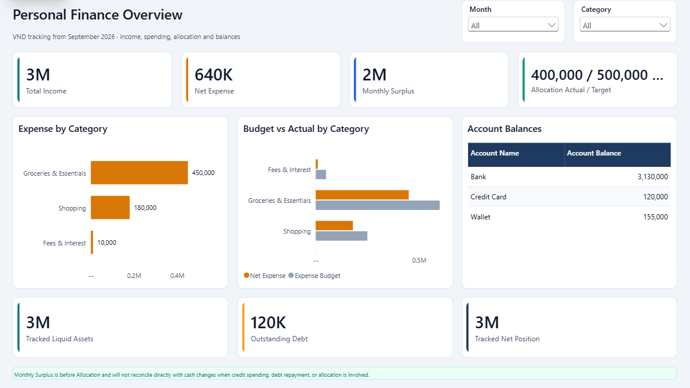

# Personal Finance Tracker

An Excel transaction-entry workbook with live balance formulas and a Power BI analytical report. The public workbook contains **12 synthetic transactions for September 2026** and three generic accounts. No personal transaction history, original workbook, or imported Power BI cache is included.

## What it does

- Records income, expenses, refunds, account transfers, allocations, and adjustments with positive VND amounts.
- Validates account/type/category combinations with an `Entry Status` formula and native Excel dropdowns.
- Calculates current asset balances and positive credit-card debt separately.
- Compares expense budgets and savings targets without counting transfers as income or spending.
- Imports the expandable Excel tables into a Power BI model with explicit DAX measures.

## Files

- `workbook/Personal_Finance_Tracker_Demo.xlsx`: synthetic example, existing layout and native validations preserved.
- `powerbi/Personal_Finance_Tracker.pbip`: Power BI report entry point, report layout/theme, Power Query, and TMDL model definitions. Imported cache and local settings are excluded.
- [Transaction and model rules](docs/model.md)
- [Synthetic fixture and expected results](docs/demo-data.md)

## Run the workbook

Open the demo workbook in desktop Microsoft Excel. The `Start` sheet explains each transaction type. Blue text denotes editable inputs; the `Summary` sheet calculates directly from the transaction table.

Keep amounts positive, enter an Excel date, and wait for `Entry Status = OK`. The Summary and account formulas exclude invalid rows, matching Power Query. Save the workbook before refreshing Power BI. Add rows inside the named Excel table, preserving its validation and the calculated status column.

## Run Power BI

1. Use a current Power BI Desktop version that supports Power BI Projects (PBIP) and TMDL. Enable project saving in Preview features if the installed version requires it, then restart Desktop.
2. Open `powerbi/Personal_Finance_Tracker.pbip`.
3. In **Transform data → Edit parameters**, set `WorkbookPath` to the absolute path of the included demo workbook. The committed parameter deliberately contains a generic placeholder, so each clone uses its own local path.
4. Apply changes and **Refresh**. If prompted, choose a local-file privacy level suitable for this synthetic example.
5. Filter the report to September 2026 and compare it with [expected results](docs/demo-data.md).

Excel is the single transaction source. This repo ships model/report definitions rather than a preloaded PBIX containing a data cache. Excel recalculation and validation were checked in native Excel. The Power BI model was refreshed from this synthetic workbook in Desktop and its DAX totals were checked against the fixture.

## Verification

The demo was recalculated in native Excel. All 12 rows pass validation; the account balances and headline outputs match the independent fixture. An invalid category was added temporarily and excluded from both spending and bank-balance calculations. A valid expense amount was changed temporarily and dependent results recalculated, then the original synthetic fixture was restored.

Power BI Desktop successfully refreshed the clean model from the included workbook. DAX queries confirmed Bank 3,130,000, Wallet 155,000, debt 120,000, assets 3,285,000, tracked net position 3,165,000 and net expense 640,000 VND. The 12 source transactions produce 8 KPI fact rows; transfers and adjustments enter the separate account-movement ledger. The repository keeps editable PBIP definitions and excludes imported caches; no PBIX is included.

The screenshot was rendered after that refresh. Its cards use rounded display units; use the fixture documentation for exact values. All data is synthetic.

## Boundaries

Monthly Surplus means income minus net expenses before allocations. It is not the change in a bank account. Tracked Net Position means tracked liquid assets minus tracked debt; it excludes untracked savings and is not complete net worth. Accounts include inactive rows for history; inactive is not a data-deletion switch.
